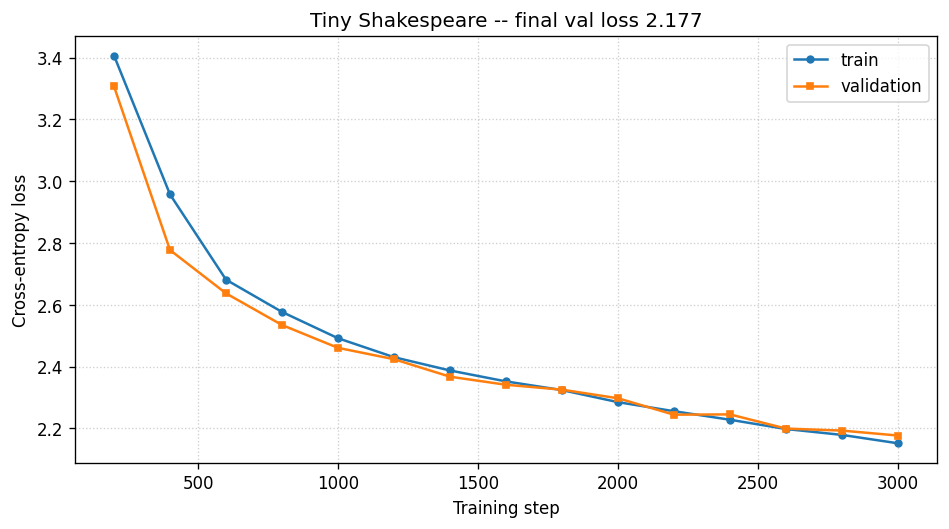

# Transformer from Scratch

A character-level decoder-only Transformer trained on Tiny Shakespeare,
implemented end-to-end in plain NumPy. Self-attention, multi-head
decomposition, layer normalisation, position encodings, residual
connections, and the AdamW training loop are all written out by hand —
no PyTorch, no JAX, no autograd.

The point is the same as the
[mnist-nn-from-scratch](https://github.com/zaidanmir/mnist-nn-from-scratch)
repo: derive the maths in `notes/`, then write code that matches the
derivation step by step. Every backward pass is verified against
finite-difference numerical gradients to ~1e-6 relative error before
training begins.

## Results

3000 training steps at `lr=3e-4`, batch=32, on a 4-layer, 4-head model
(d_model=64, block_size=64, ~208K parameters). 3 minutes total on CPU.



| | Final value |
|---|---:|
| Train loss | 2.151 |
| Validation loss | **2.177** |
| Initial (uniform predictions) | log(65) ≈ 4.17 |
| Steps/sec on CPU | ~17 |

The train and val losses track each other closely — no overfitting at
this scale and budget.

### Generated samples (temperature=0.8, top_k=40)

After 3000 steps the model has learned the basic structure of Shakespeare:
character names with colons, line breaks, dialogue formatting,
English-like word lengths and bigrams. Words aren't yet correct vocabulary
(this is character-level — every "word" is invented), but the rhythm and
shape are recognisably Shakespeare.

```
ROMEO:
Sherers, tay hat exe tre seald I's the and therty
o whe my y is in it, arme the
We ereseme beppoold has asone so's the,
And masgle hen tay an wall Hertie to hepkeer,
thastood ad domere sure
Mepond spuknd you than's unou: thel thea thene:
```

```
HAMLET:
I'l so masere are sort demp hichs in,
I Bum heard hord some,
Indrithen, hay be wo dead hallioun ownt hatliche
Yomen to lrothall a ear cene.

ESING DORA:
Thay the mand his glond hall delly as pad;
```

With more compute (10K+ steps and a larger model) the samples become
substantially more legible. The current results are produced in 3 minutes
of CPU time — they prove the implementation trains and converges, not
that it's a state-of-the-art language model.

## Architecture

```
input tokens (B, T)
    │
    ├─► token embedding   (V × d)
    ├─► + sinusoidal position encoding
    │
    ├─► [ Transformer block ] × N_layers       ← pre-LN
    │     ├─ LayerNorm
    │     ├─ Multi-head causal self-attention
    │     ├─ residual
    │     ├─ LayerNorm
    │     ├─ position-wise MLP
    │     └─ residual
    │
    ├─► LayerNorm (final)
    └─► Linear (LM head, d → V) → logits (B, T, V)
```

Default configuration:

| | |
|---|---:|
| `d_model` | 64 |
| `n_heads` | 4 |
| `n_layers` | 4 |
| `block_size` | 64 |
| `d_ff` | 256 (= 4 × `d_model`) |
| Vocabulary size | 65 (character-level) |
| Total parameters | ~208,000 |

## Math derivations

Each module references back to the matching note. All forward and
backward passes are verified against finite-difference numerical gradients
before training:

- [`notes/attention.md`](notes/attention.md) — scaled dot-product
  attention, the variance argument for the √dₖ scaling, multi-head
  decomposition, sinusoidal position encoding, complexity tradeoff.
- [`notes/attention_backward.md`](notes/attention_backward.md) — chain
  rule through softmax (the row-centred-gradient trick), the masked-zero
  property, and the QKV projection backward.
- [`notes/layer_norm.md`](notes/layer_norm.md) — three-term backward
  through normalisation accounting for both μ and σ being functions of
  every input element in the row.

## How to run

```bash
git clone https://github.com/zaidanmir/transformer-from-scratch.git
cd transformer-from-scratch
python3 -m venv .venv
source .venv/bin/activate
pip install -r requirements.txt

# Train (~3 min on CPU, no GPU needed)
python train.py

# Verify backward passes (~5 sec)
python -m src.attention      # attention gradient check
python -m src.layer_norm     # layer norm gradient check
python -m src.block          # full block gradient check

# Run unit tests
python -m unittest discover tests
```

A `Makefile` wraps the same commands: `make install`, `make train`,
`make gradcheck`, `make test`.

## Project structure

```
transformer-from-scratch/
├── README.md
├── LICENSE
├── requirements.txt
├── train.py                  # CLI entrypoint: train + sample
├── src/
│   ├── data.py               # Tiny Shakespeare loader, char tokenizer, batches
│   ├── embedding.py          # TokenEmbedding + sinusoidal position encoding
│   ├── layers.py             # Linear (3D-aware), ReLU
│   ├── losses.py             # log_softmax + cross_entropy_loss
│   ├── attention.py          # MultiHeadSelfAttention forward + backward
│   ├── layer_norm.py         # LayerNorm forward + backward
│   ├── mlp.py                # Position-wise feed-forward
│   ├── block.py              # Transformer block (pre-LN + residuals)
│   ├── model.py              # GPT: embed + N blocks + final LN + LM head
│   ├── optim.py              # AdamW
│   ├── train.py              # Training loop with val-loss tracking
│   ├── sample.py             # Autoregressive sampling (temp + top-k)
│   └── gradcheck.py          # Finite-difference gradient verification
├── notes/
│   ├── attention.md
│   ├── attention_backward.md
│   └── layer_norm.md
├── experiments/
│   └── plot_loss.py
├── tests/
│   └── test_pipeline.py      # 17 unit tests
├── figures/
│   └── loss_curves.png
└── data/                     # Downloaded corpus (gitignored)
```

## Implementation notes

- **No autograd.** Every backward pass is implemented and gradient-checked
  by hand. The `relative_error` metric in `src/gradcheck.py` clips its
  denominator at 1e-4 of the global gradient scale so theoretically-zero
  gradients (e.g. the K-bias gradient is exactly 0 because softmax is
  shift-invariant — adding a constant to all keys leaves attention weights
  unchanged) don't blow up the metric on finite-difference noise.
- **Pre-LN over post-LN.** LayerNorm is applied *before* each sub-layer
  (attention / MLP) inside the residual, not after. Pre-LN trains stably
  without the warmup schedule that post-LN historically needed (Xiong et
  al. 2020).
- **Combined QKV projection.** Q, K, V come from one shared
  `(d_model, 3 × d_model)` weight matrix that's split after the matmul,
  rather than three separate matmuls — same parameter count, single
  larger matmul that vectorises better.
- **Multi-head as a reshape.** All H heads run jointly through one
  batched matmul over the head axis: a single `(B, H, T, T)` attention
  computation rather than H independent `(B, T, T)` ones.
- **Causal mask in scores, not weights.** Setting `scores[..., j > i] = -∞`
  before softmax is equivalent to `weights[..., j > i] = 0` post-softmax
  *while preserving the probability simplex* — the masked tokens'
  attention mass is correctly absorbed by other tokens. Setting weights
  to 0 directly would leave each row summing to less than 1.
- **AdamW with parameter-shape-aware weight decay.** Decoupled weight
  decay (Loshchilov & Hutter 2017) applied only to matrix-shaped
  parameters; biases, LayerNorm scales/shifts, and embedding weights are
  exempt. Standard practice for transformer LMs.

## References

- Vaswani et al. (2017), [*Attention Is All You Need*](https://arxiv.org/abs/1706.03762)
  — the original Transformer.
- Phuong & Hutter (2022), [*Formal Algorithms for Transformers*](https://arxiv.org/abs/2207.09238)
  — concise pseudocode reference used to verify derivations.
- Ba et al. (2016), [*Layer Normalization*](https://arxiv.org/abs/1607.06450).
- Loshchilov & Hutter (2017), [*Decoupled Weight Decay Regularization*](https://arxiv.org/abs/1711.05101) — AdamW.
- Xiong et al. (2020), [*On Layer Normalization in the Transformer Architecture*](https://arxiv.org/abs/2002.04745) — pre-LN vs post-LN.
- Karpathy, [*nanoGPT*](https://github.com/karpathy/nanoGPT) — referenced
  for architectural conventions only; this implementation derives the
  math independently.

## Dataset

[Tiny Shakespeare](https://github.com/karpathy/char-rnn/blob/master/data/tinyshakespeare/input.txt)
— ~1MB of Shakespeare's plays concatenated, character-level (vocabulary
of 65). Downloaded automatically on first training run.
